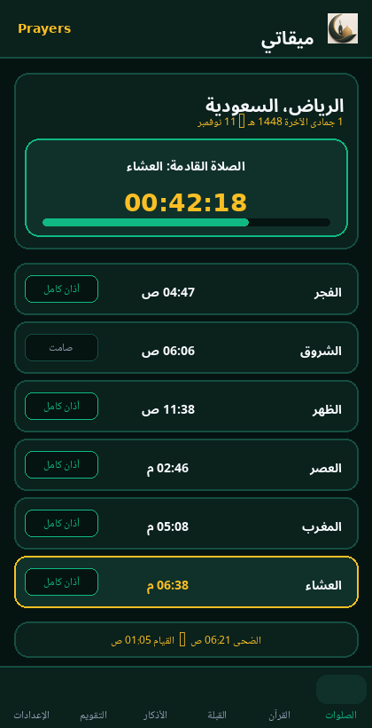
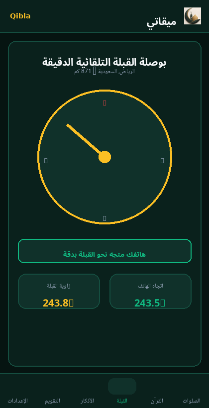
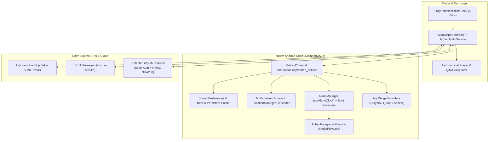
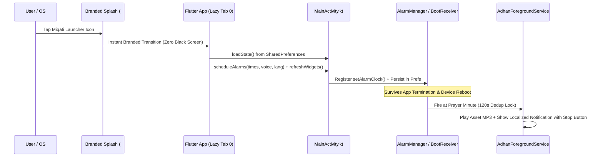

<div align="center">


# Miqati • ميقاتي

**A Complete, Lightweight, Offline-First Islamic Companion Built with Flutter, Dart & Native Android**

*Accurate Astronomical Prayer Times • Zero-Kill Background Adhan • 604-Page Connected Mushaf • 6 Sunni Tafsirs • Multi-Sensor Live Qibla • Hisn al-Muslim Book • Home Screen Widgets • Protected Admin Console*

[](https://flutter.dev)
[](https://dart.dev)
[](https://developer.android.com)
[](https://developer.apple.com)
[](#)

<p dir="rtl" align="center">
<b>ميقاتي (Miqati)</b> — تطبيق إسلامي متكامل وخفيف ومفتوح التطوير مبني بـ <b>Flutter & Dart</b> مع طبقة أصلية متقدمة لنظام أندرويد. يجمع بين دقة مواقيت الصلاة، الأذان التلقائي في الخلفية حتى بعد إغلاق التطبيق أو إعادة تشغيل الجهاز، المصحف الشريف بوضعية الكتاب (604 صفحات)، 6 تفاسير سنية معتمدة، البوصلة الحية للقبلة، كتاب حصن المسلم، ودجت الشاشة الرئيسية، ولوحة تحكم سرية محمية.
</p>

</div>

---

## Table of Contents • فهرس المحتويات

1. [Screenshots • صور أقسام التطبيق](#screenshots--صور-أقسام-التطبيق)
2. [Core Features • المميزات التفصيلية](#core-features--المميزات-التفصيلية)
3. [System Architecture & Diagrams • المخططات الهندسية](#system-architecture--diagrams--المخططات-الهندسية)
4. [Project Structure • هيكل الملفات](#project-structure--هيكل-الملفات)
5. [Requirements & Tools • المتطلبات والأدوات وروابطها](#requirements--tools--المتطلبات-والأدوات-وروابطها)
6. [Step-by-Step Installation & Build • خطوات التثبيت والتشغيل](#step-by-step-installation--build--خطوات-التثبيت-والتشغيل)
7. [Android Native & Home Widgets • تكامل أندرويد والودجات](#android-native--home-widgets--تكامل-أندرويد-والودجات)
8. [Customization & Security • التخصيص والأمان](#customization--security--التخصيص-والأمان)
9. [Open-Source Data Sources • المصادر المفتوحة المعتمدة](#open-source-data-sources--المصادر-المفتوحة-المعتمدة)
10. [Troubleshooting • حل المشكلات الشائعة](#troubleshooting--حل-المشكلات-الشائعة)
11. [Contact & Developer • المطور والتواصل](#contact--developer--المطور-والتواصل)

---

## Screenshots • صور أقسام التطبيق

<div align="center">

| Prayers & Countdown (`الصلوات`) | Holy Quran & Mushaf (`القرآن الكريم`) | Live Qibla Compass (`القبلة`) |
| :---: | :---: | :---: |
|  |  |  |

| Hisn al-Muslim & Tasbih (`الأذكار`) | Hijri Calendar & Occasions (`التقويم`) | Advanced Settings (`الإعدادات`) |
| :---: | :---: | :---: |
|  |  |  |

</div>

---

## Core Features • المميزات التفصيلية

### 1. Astronomical Prayer Times & Zero-Kill Background Adhan (`مواقيت الصلاة والأذان بالخلفية`)
- **9 Verified Calculation Methods**: Supports **Umm al-Qura University (Makkah)**, **Muslim World League (MWL)**, **Egyptian General Authority of Survey**, **University of Islamic Sciences (Karachi)**, **ISNA (North America)**, **Dubai / UAE**, **Qatar Calendar House**, **Kuwait Awqaf**, and **Morocco Habous**.
- **Automatic City & Country Detection**: Uses Android `LocationManager` + `Geocoder` to resolve your exact **City & Country** cleanly on the Home screen (with nearest-city fallback instead of exposing raw GPS coordinates).
- **Reliable Background & Reboot Execution**: Uses `AlarmManager.setAlarmClock` + `AdhanForegroundService` (`foregroundServiceType="mediaPlayback"`) + `BOOT_COMPLETED`, `LOCKED_BOOT_COMPLETED`, `QUICKBOOT_POWERON`, `TIME_CHANGED`, and `TIMEZONE_CHANGED` receivers so Adhan fires reliably even when the app is swiped away or after rebooting the phone.
- **Notification Shade Action & Deduplication**: Localized **"⏹ Stop Adhan / إيقاف الأذان"** button directly in the notification shade, paired with a **120-second deduplication lock** to prevent duplicate Adhan playback.
- **Per-Prayer Modes & Sunnah Timings**: Cycle any prayer between **Full Adhan (`أذان كامل`)**, **Takbir (`تكبير`)**, **Alert (`تنبيه`)**, and **Silent (`صامت`)**, view **Iqamah** countdowns, **Duha**, **Midnight**, and **Last Third of the Night**, and track your daily 5 prayers (future prayers remain locked `🔒` until their Adhan enters).

### 2. Holy Quran, 604-Page Book Mode, Streaming Audio & 6 Sunni Tafsirs (`القرآن الكريم`)
- **Offline-First Storage**: On first launch, downloads and permanently caches the complete Uthmani Quran (`quran-uthmani`) and Sahih International English translation (`en.sahih`) in `filesDir/miqati_offline_cache/` for instant offline access across all 114 Surahs and 604 pages.
- **True 604-Page Book Flip Mode (`وضعية الكتاب`)**: Smooth, non-destructive `PageView.builder` with RTL horizontal page swiping, adjacent-page preloading, **Save Page (`حفظ الصفحة`)**, **Jump to Saved Page**, and **Full-Screen Mushaf** reading.
- **Streaming Recitation & Auto-Highlight**: Streams Ayah-by-Ayah and full-Surah audio via `MediaPlayer.prepareAsync()` (with local cache fallback) from **Mishary Alafasy**, **Mahmoud Khalil Al-Husary**, **Abdul Basit Abdus Samad**, and **Muhammad Siddiq Al-Minshawi**, highlighting active verses automatically and supporting tap-to-play on any Ayah.
- **6 Trusted Sunni Tafsirs (`تفاسير أهل السنة والجماعة`)**:
  1. **التفسير الميسر** (*Al-Tafsir Al-Muyassar — King Fahd Complex*)
  2. **تفسير ابن كثير** (*Tafsir Ibn Kathir*)
  3. **تفسير السعدي** (*Tafsir Al-Saadi*)
  4. **تفسير الطبري** (*Tafsir Al-Tabari*)
  5. **تفسير القرطبي** (*Tafsir Al-Qurtubi*)
  6. **تفسير البغوي** (*Tafsir Al-Baghawi*)
- **Bilingual Reading (`عربي` / `EN`)**, adjustable font size, cream paper mode, verse search, copy-to-clipboard, and inline `🔖` bookmark markers.

### 3. Live Dynamic Qibla Compass (`بوصلة القبلة التلقائية`)
- Simultaneously registers `TYPE_ROTATION_VECTOR`, `TYPE_ACCELEROMETER`, `TYPE_MAGNETIC_FIELD`, and `TYPE_ORIENTATION` with `GeomagneticField` magnetic declination compensation.
- Displays the Kaaba directional indicator, live Qibla bearing, device heading, distance to Makkah (km), and turn-right/turn-left guidance fully localized in Arabic and English.

### 4. Hisn al-Muslim Book & Persistent Tasbih (`حصن المسلم والمسبحة`)
- Dynamically fetches and caches the complete open-source **Hisn al-Muslim (`حصن المسلم`)** chapters from `rn0x/Adhkar-json` into a swipeable `PageView.builder` book with chapter search, copy, bookmarking, tap-to-count, and persistent Tasbih memory.

### 5. Hijri Calendar & Automated Occasion Notifications (`التقويم الهجري والمناسبات`)
- Interactive monthly Hijri/Gregorian calendar highlighting **Fridays** in emerald, color-coded Islamic occasions, live countdowns (`متبقي X يوم`), and automatic system notifications **on the day of Eids/occasions and 1–2 days prior**.

### 6. Native Android Home Screen Widgets (`ودجات سطح المكتب`)
- **Prayer Times Widget (`MiqatiPrayerWidgetProvider`)**: Shows city, next prayer, and all 5 daily prayer times.
- **Daily Quran Widget (`MiqatiQuranWidgetProvider`)**: Displays a daily Quranic verse and your saved Mushaf page.
- **Adhkar & Tasbih Widget (`MiqatiAdhkarWidgetProvider`)**: Displays rotating authentic Adhkar with an interactive **`+ سبّح`** counter directly on the home screen.
- **One-Tap Pinning**: Available from **Settings → Add Home Screen Widget** using Android's `AppWidgetManager.requestPinAppWidget`.

### 7. Hidden Admin Console & Protected Cloud Push (`لوحة الإدارة المخفية`)
- **Stealth Access**: Zero visible buttons in the UI; unlocked via **5 rapid taps** on the header logo or typing `#777#` in the Quran search field, verified via SHA-256 hashing.
- **4 Organized Tabs**:
  1. **Analytics & Charts**: Real device install ID, real usage KPIs, and 7-day `CustomPaint` activity bar chart (zero mock devices).
  2. **Advanced Push Composer**: Send **HMAC-SHA256** signed, Basic-Auth protected cloud notifications (`ntfy.sh`) with timestamp deduplication so old alerts are never replayed.
  3. **Branding, Offsets & Policies**: Edit app name, prayer minute offsets (`± min`), and **About / Privacy Policy** texts live.
  4. **User Inbox**: Review messages submitted through the **Contact Us** modal form.

---

## System Architecture & Diagrams • المخططات الهندسية

### High-Level Layered Architecture



### Offline-First Startup & Background Adhan Sequence



---

## Project Structure • هيكل الملفات

```text
MiqatiCompleteFlutterProject/
├── README.md
├── pubspec.yaml
├── assets/
│   ├── audio/
│   │   ├── adhan_main.mp3
│   │   ├── adhan_fajr.mp3
│   │   ├── adhan_makkah.mp3
│   │   ├── adhan_madinah.mp3
│   │   └── takbir.mp3
│   └── logo/
│       └── app_logo.png
├── docs/
│   └── screenshots/
│       ├── prayers.png
│       ├── quran.png
│       ├── qibla.png
│       ├── adhkar.png
│       ├── calendar.png
│       └── settings.png
├── android/
│   ├── build.gradle
│   ├── settings.gradle
│   ├── gradle.properties
│   └── app/
│       ├── build.gradle
│       └── src/main/
│           ├── AndroidManifest.xml
│           ├── kotlin/com/miqati/app/
│           │   ├── MainActivity.kt
│           │   └── MiqatiWidgets.kt
│           └── res/
│               ├── drawable/ (launch_background.xml, widget_bg.xml, ic_miqati_logo.png)
│               ├── layout/ (widget_prayers.xml, widget_quran.xml, widget_adhkar.xml)
│               ├── mipmap-*/ (ic_launcher.png, ic_launcher_round.png)
│               ├── values/ & values-night/ (styles.xml)
│               └── xml/ (widget_prayers_info.xml, widget_quran_info.xml, widget_adhkar_info.xml)
├── lib/
│   ├── main.dart
│   ├── config/
│   │   ├── app_branding_and_sounds.dart
│   │   └── miqati_theme.dart
│   ├── core/
│   │   ├── audio/adhan_audio_service.dart
│   │   └── localization/app_localizations.dart
│   └── features/
│       ├── admin/ (admin_controller.dart, secret_admin_vault_screen.dart)
│       ├── adhkar/ (adhkar_zakat_screen.dart)
│       ├── calendar/ (hijri_calendar_screen.dart)
│       ├── home/ (miqati_home_shell.dart)
│       ├── prayer_times/ (prayer_calculator.dart, prayers_screen.dart)
│       ├── qibla/ (qibla_screen.dart)
│       ├── quran/ (quran_open_source_service.dart, quran_screen.dart)
│       └── settings/ (settings_screen.dart)
└── tools/
    ├── MainActivity_template.kt
    ├── MiqatiWidgets_template.kt
    ├── customize_miqati.py
    └── setup_android_native.py
```

---

## Requirements & Tools • المتطلبات والأدوات وروابطها

| Tool / SDK | Minimum Version | Purpose | Official Download & Docs |
| :--- | :--- | :--- | :--- |
| **Flutter SDK** | `>= 3.2.0` | Cross-platform UI framework & compiler | [docs.flutter.dev/get-started/install](https://docs.flutter.dev/get-started/install) |
| **Dart SDK** | `>= 3.2.0` | Language runtime (bundled with Flutter) | [dart.dev/get-dart](https://dart.dev/get-dart) |
| **Android Studio** | Latest Stable | Android SDK, Platform Tools & Emulator | [developer.android.com/studio](https://developer.android.com/studio) |
| **Android SDK** | API 24–35 | `minSdk 24`, `compileSdk 35`, `targetSdk 35` | [developer.android.com/tools](https://developer.android.com/tools) |
| **Java (JDK)** | `JDK 17` | Required by Android Gradle Plugin | [adoptium.net](https://adoptium.net/) |
| **Python 3** | `>= 3.8` | Runs `setup_android_native.py` injector | [python.org/downloads](https://www.python.org/downloads/) |
| **Git** | Latest | Cloning and version control | [git-scm.com/downloads](https://git-scm.com/downloads) |
| **Xcode** *(macOS)* | Latest | Required only for iOS builds | [developer.apple.com/xcode](https://developer.apple.com/xcode/) |

---

## Step-by-Step Installation & Build • خطوات التثبيت والتشغيل

### 1. Install Required Tools (Linux / Kali / Ubuntu Example)

```bash
# Install Git, Python 3, OpenJDK 17, and Android ADB tools
sudo apt update && sudo apt install -y git python3 openjdk-17-jdk adb unzip curl

# Verify Java & Flutter environment
java -version
flutter doctor -v
```

### 2. Clone & Configure the Project

```bash
# Clone your GitHub repository
git clone https://github.com/<YOUR_USERNAME>/miqati.git
cd miqati

# (If you regenerated the android/ folder via `flutter create --platforms=android .`)
# Run the native injector to configure permissions, widgets, splash, icons & sensors:
python3 tools/setup_android_native.py
```

### 3. Fetch Dependencies & Run on Connected Android Device

```bash
# Check connected device ID (via USB Debugging)
adb devices
flutter devices

# Clean, fetch packages, and launch in release mode
flutter clean
flutter pub get
flutter run --release
```

### 4. Build a Standalone Release APK

```bash
flutter build apk --release
# Output: build/app/outputs/flutter-apk/app-release.apk
```

---

## Android Native & Home Widgets • تكامل أندرويد والودجات

- **Permissions Declared**: `INTERNET`, `ACCESS_FINE_LOCATION`, `ACCESS_COARSE_LOCATION`, `POST_NOTIFICATIONS`, `SCHEDULE_EXACT_ALARM`, `USE_EXACT_ALARM`, `FOREGROUND_SERVICE`, `FOREGROUND_SERVICE_MEDIA_PLAYBACK`, `RECEIVE_BOOT_COMPLETED`, `WAKE_LOCK`, `VIBRATE`.
- **Xiaomi / MIUI / HyperOS Note**: For uninterrupted background Adhan when the screen is off, open **Settings → Enable Auto-Start & Battery Exemption** inside Miqati and set Battery Saver to **No restrictions**.
- **Adding Home Screen Widgets**:
  - **In-App**: Go to **Settings → Add Home Screen Widget** and choose **Prayers**, **Quran**, or **Adhkar & Tasbih** to trigger Android's native pin dialog.
  - **Manual**: Long-press your home screen → **Widgets** → **Miqati • ميقاتي**.

---

## Customization & Security • التخصيص والأمان

1. **Change Default Admin Password (Required Before Release)**:
   Edit `lib/config/app_branding_and_sounds.dart` and replace the placeholder with your own private password:
   ```dart
   static const String defaultAdminPasswordPlain = '<YOUR_ADMIN_PASSWORD>';
   ```
   Update the matching cloud credentials (`cloudAccountUsername`, `cloudAccountPassword`, `cloudTopicChannel`) in `lib/features/admin/admin_controller.dart`.
2. **Replace App Logo & Icons**:
   Overwrite `assets/logo/app_logo.png` with your own 512×512 PNG and run `python3 tools/setup_android_native.py` to regenerate all `mipmap-*` launcher icons and notification drawables.
3. **Customize Adhan Voices**:
   Add `.mp3` files under `assets/audio/` and register clean localized display names in `AppBrandingAndSounds.defaultAdhanVoices`.

---

## Open-Source Data Sources • المصادر المفتوحة المعتمدة

- **Holy Quran & Translations**: [Al Quran Cloud API](https://alquran.cloud/api) & [Tanzil.net](https://tanzil.net/)
- **Quran Audio Recitations**: [Al Quran Cloud CDN](https://alquran.cloud/cdn) & [EveryAyah](https://everyayah.com/)
- **Sunni Tafsirs**: [spa5k/tafsir_api](https://github.com/spa5k/tafsir_api)
- **Hisn al-Muslim (حصن المسلم)**: [rn0x/Adhkar-json](https://github.com/rn0x/Adhkar-json)
- **Prayer & Hijri Standards**: [Umm al-Qura Official Calendar](https://www.ummulqura.org.sa/en)

---

## Troubleshooting • حل المشكلات الشائعة

| Issue | Solution |
| :--- | :--- |
| **Widgets not appearing in launcher** | Run `python3 tools/setup_android_native.py` then `flutter clean && flutter run --release`. |
| **Adhan delayed on Xiaomi/MIUI** | Tap **Enable Auto-Start & Battery Exemption** in Settings and enable **Autostart**. |
| **Gradle / AGP version warning** | Warnings from newer Flutter channels are non-blocking; use `--android-skip-build-dependency-validation` if needed. |

---

## Contact & Developer • المطور والتواصل

- **Developer**: Abdlateef Mohamed — **Latifs MutiServs**
- **Email**: [a@latifs.site](mailto:a@latifs.site)

---

<div align="center">
<sub>Built with care for the Muslim Ummah • صُنع بإتقان لخدمة المسلمين</sub><br/>
<sub><i>Development Note: Artificial intelligence tools were utilized to assist in the design, architecture, and refinement of this project. • ملاحظة: تمت الاستعانة بأدوات ذكاء اصطناعي للمساعدة في تطوير وتحسين هذا المشروع.</i></sub>
</div>
