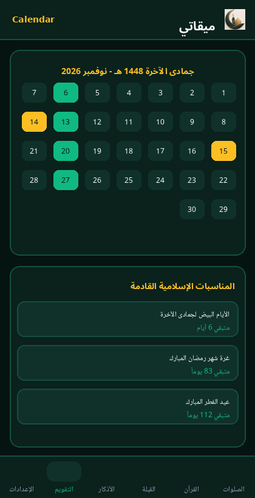
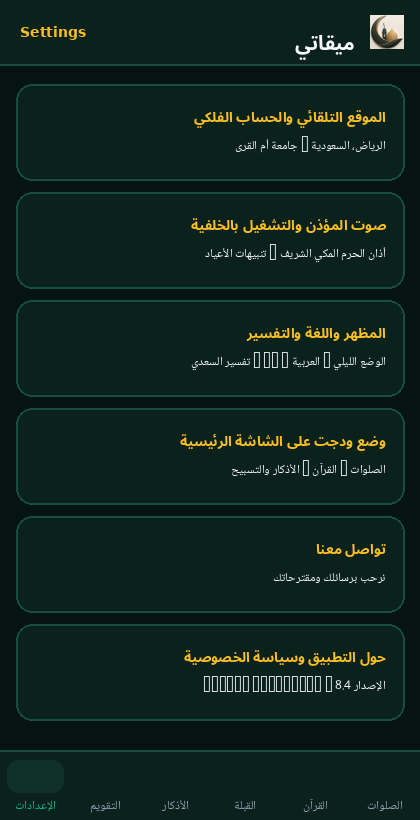
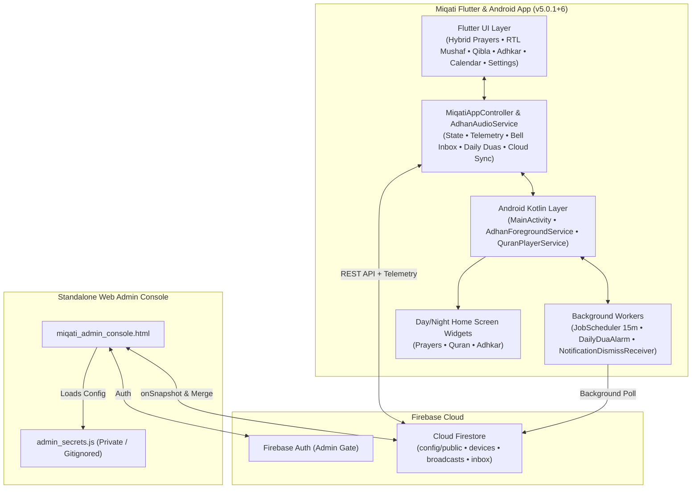

<div align="center">


# Miqati • ميقاتي

**A Complete, Lightweight, Offline-First Islamic Companion & Standalone Cloud Admin Ecosystem**

*Hybrid Astronomical Prayer Times • Zero-Kill Background Adhan • 604-Page RTL Connected Mushaf • 6 Sunni Tafsirs • 8 Reciters • Multi-Sensor Islamic Qibla • Hisn al-Muslim • Bell Notification Center & Daily Dua Cards • Day/Night Home Screen Widgets • Standalone Firebase Admin Console*

[](https://github.com/alateefs/Miqati/releases/)
[](https://flutter.dev)
[](https://dart.dev)
[](https://kotlinlang.org)
[](https://developer.android.com)
[](https://firebase.google.com)

</div>

---

## Table of Contents

1. [Introduction & Technical Overview](#introduction--technical-overview)
2. [Screenshots](#screenshots)
3. [Core Features](#core-features)
4. [System Architecture & Diagrams](#system-architecture--diagrams)
5. [Project Structure](#project-structure)
6. [Tech Stack, Environments & Requirements](#tech-stack-environments--requirements)
7. [Step-by-Step Installation, Modification & Build](#step-by-step-installation-modification--build)
8. [Android Native Integration & Home Widgets](#android-native-integration--home-widgets)
9. [Standalone Cloud Admin Console & Security](#standalone-cloud-admin-console--security)
10. [Open-Source Data & Audio Sources](#open-source-data--audio-sources)
11. [Troubleshooting](#troubleshooting)
12. [Contact & Developer](#contact--developer)

---

## Introduction & Technical Overview

**Miqati (ميقاتي)** is a full-scale, production-ready Islamic companion platform engineered with a strict **offline-first** philosophy, combining a lightweight **Flutter & Dart** cross-platform user interface with a deeply integrated **Android Kotlin** native runtime and a **Standalone Firebase Web Admin Console**. Designed to remain fast, battery-conscious, and visually calm in both **Warm Parchment Day** and **Deep Slate-Teal Dark** themes, Miqati eliminates bloat while delivering reliable daily worship tools that continue operating even when the application is closed or the device is rebooted.

Unlike typical prayer apps that rely on fragile client-side timers or heavyweight third-party SDKs, Miqati delegates mission-critical background responsibilities—including exact prayer alarms (`AlarmManager.setAlarmClock`), partial wake-lock audio playback (`AdhanForegroundService`), continuous Quran recitation (`QuranPlayerService`), periodic background cloud synchronization (`JobScheduler`), daily Dua scheduling (`DailyDuaAlarmReceiver`), bidirectional notification dismissal tracking (`NotificationDismissReceiver`), magnetic-north compass fusion, GPS/Geocoder resolution, and home-screen widgets—directly to **native Android Kotlin components** bridged via a clean `MethodChannel` (`com.miqati.app/adhan_service`).

For remote operations, Miqati replaces legacy in-app hidden admin menus with an **independent, browser-based Cloud Admin Console** (`miqati_admin_console.html`) powered by **Firebase Authentication**, **Cloud Firestore**, **Tailwind CSS**, and **Chart.js**. Sensitive Firebase configuration is isolated inside an external, gitignored `admin_secrets.js` file, ensuring that public repositories never expose administrative credentials. Meanwhile, the mobile client communicates with Firestore via lightweight, zero-bloat **REST API** calls, keeping the compiled release APK compact (`arm64-v8a` / `armeabi-v7a` ABI filtering, R8 code shrinking, resource shrinking, and PNG crunching).

### Programming Languages & Environments Used

- **Dart (`>=3.2.0`) & Flutter (`3.x`)**: Powers the reactive UI, custom painters (scenic mosque horizon, ornate Islamic Qibla arrow), state management (`MiqatiAppController`), astronomical prayer/Qibla math, and offline JSON caching.
- **Kotlin (JVM 17) & Android SDK (API 24–35)**: Powers `MainActivity.kt`, foreground media services, exact alarms, `JobScheduler` background polling, `MediaStore` gallery image export, `FileProvider` sharing, `AppWidgetProvider` home widgets, and Unicode Bidi notification formatting.
- **XML & Gradle (Groovy)**: Configures Android permissions, receivers, services, R8/ProGuard optimization, and compact Day/Night widget layouts.
- **HTML5, Tailwind CSS, Vanilla JavaScript & Chart.js**: Powers the standalone `miqati_admin_console.html` dashboard with real-time `onSnapshot` listeners and analytics charts.
- **Python 3 (with Pillow)**: Automates native Android injection (`tools/setup_android_native.py`), transparent logo/notification icon generation, and build-time asset preparation.

---

## Screenshots

<div align="center">

| Prayers & Countdown (`الصلوات`) | Holy Quran & Mushaf (`القرآن الكريم`) | Live Qibla Compass (`القبلة`) |
| :---: | :---: | :---: |
|  |  |  |

| Hisn al-Muslim & Tasbih (`الأذكار`) | Hijri Calendar & Occasions (`التقويم`) | Advanced Settings (`الإعدادات`) |
| :---: | :---: | :---: |
|  |  |  |

</div>

---

## Core Features

### 1. Hybrid Prayer Times & Dedicated Adhan Settings
- **Hybrid Single-Screen Layout**: Combines a scenic celestial mosque-horizon hero card (live clock, next prayer name, 12-hour time, live countdown, progress bar, and resolved city) with a compact Date/Sunrise bar, a `3×2` grid of all 6 daily times with Iqamah badges (`+Xm`), and a 3-column Sunnah strip (**Duha**, **Midnight**, **Last Third**) fitting on one screen without scrolling.
- **9 Astronomical Calculation Methods**: Supports **Umm al-Qura (Makkah)**, **Muslim World League (MWL)**, **Egyptian General Authority**, **Karachi**, **ISNA**, **UAE/Dubai**, **Qatar**, **Kuwait**, and **Morocco**.
- **Independent Adhan Settings Screen**:
  - Master background Adhan toggle and per-prayer modes (**Full Adhan**, **Takbir Only**, **Silent Alert**, **Disabled**).
  - Independent volume slider (`0%–100%`) or **Follow Device Volume** scaling, accurately respected in both live prayer triggers and in-app Adhan testing.
  - **Bundled Offline Voices**: `adhan_main.mp3`, `adhan_makkah.mp3`, `adhan_madinah.mp3`, `adhan_madinah2.mp3`, `adhan_fajr.mp3`, and `takbir.mp3`.
  - **8 Curated Online Muezzin Adhans**: Named recordings sourced from [IslamCan](https://www.islamcan.com/audio/adhan/index.shtml) that download on first playback and cache persistently in `filesDir/adhan_cache/` for offline use thereafter, plus real-time cloud voices added from the Admin Console.
  - **Reliability**: `AlarmManager.setAlarmClock`, `PARTIAL_WAKE_LOCK`, 120-second deduplication lock, localized notification **"Stop Adhan"** button, and automatic rescheduling on boot/timezone change.

### 2. Connected 604-Page Mushaf, Background Audio & 6 Sunni Tafsirs
- **True RTL Book-Flip Mushaf**: Smooth `PageView.builder` across all 604 pages with natural right-to-left page turning, ornate Surah banners, separate Bismillah headers (excluding Al-Fatihah and At-Tawbah), Juz/Surah/Page jumping, saved-page bookmarking, and full-screen reading mode.
- **8 Reciters & Background Media Notification**: Continuous Ayah-by-Ayah playback via `QuranPlayerService` with lock-screen and notification controls (Previous, Pause/Resume, Next, Stop) synchronized with an in-app mini-player bar.
- **6 Authentic Sunni Tafsirs**: Integrated verse-by-verse exegesis (*Al-Muyassar*, *Ibn Kathir*, *Al-Saadi*, *Al-Tabari*, *Al-Qurtubi*, *Al-Baghawi*) with offline caching.

### 3. Islamic Qibla Compass
- **True Magnetic North**: Prioritizes `TYPE_ACCELEROMETER` + `TYPE_MAGNETIC_FIELD` with `GeomagneticField` magnetic declination compensation and adaptive smoothing (`0.25` steady / `0.45` fast turns) to avoid relative-yaw drift.
- **Ornate Islamic Arrow**: Custom-painted Mihrab-inspired dual-tone gold and emerald arrow featuring an 8-pointed Islamic star (*Rub el Hizb*) hub ornament, live degree delta, and distance to Makkah.

### 4. Hisn al-Muslim Adhkar & Persistent Tasbih
- Fetches and caches the full **Hisn al-Muslim** collection with chapter search, full-reading and card modes, persistent electronic Tasbih counter, bookmarks, and a **Copy** button on every Dhikr.

### 5. Bell Notification Center & Shareable Daily Unique Duas
- **Top AppBar Bell Icon**: Displays live unread count and opens a categorized inbox (**All**, **Important**, **Updates**, **Daily Duas**).
- **Background Sync & Bidirectional Dismissal**: `MiqatiBackgroundSyncJobService` (`JobScheduler`, 15-minute periodic, persisted across reboots) and `DailyDuaAlarmReceiver` deliver alerts even when the app is closed. Swiping away a notification from Android's shade triggers `NotificationDismissReceiver` (`deleteIntent`) and removes it from the in-app Bell Inbox (and vice versa).
- **Elegant Daily Dua Cards**: Generates a unique daily Dua (or an Admin-configured override) rendered as an ornate Islamic card that users can **Save as PNG to Gallery (`Pictures/Miqati`)**, **Copy**, or **Share**.
- **Notification Policy & Bidi Enforcement**: Users can toggle Daily Duas and General Alerts in Settings, while **App Update notifications remain mandatory**. Arabic notification text is automatically wrapped with Unicode RTL marks (`\u200F\u2067...\u2069`) so it renders right-to-left even when the app language is English.

### 6. Compact Day/Night Home Screen Widgets & Branded Splash
- **3 Theme-Adaptive Widgets**: Compact **Prayer Times**, **Quran Surah Player (`◀` / `▶`)**, and **Adhkar & Tasbih** widgets that automatically follow the app's Day/Night theme and AR/EN language with zero wasted space.
- **Transparent Branded Splash & Notification Icon**: Flood-filled transparent `app_logo.png` shown with the app name and loading indicator at startup, paired with a monochrome white-on-transparent `ic_stat_miqati.png` notification icon.

---

## System Architecture & Diagrams



---

## Project Structure

```text
Miqati/
├── pubspec.yaml
├── assets/
│   ├── audio/
│   │   ├── adhan_main.mp3
│   │   ├── adhan_makkah.mp3
│   │   ├── adhan_madinah.mp3
│   │   ├── adhan_madinah2.mp3
│   │   ├── adhan_fajr.mp3
│   │   └── takbir.mp3
│   └── logo/
│       └── app_logo.png
├── android/
│   └── app/
│       ├── build.gradle
│       └── src/main/
│           ├── AndroidManifest.xml
│           ├── kotlin/com/miqati/app/
│           │   ├── MainActivity.kt
│           │   └── MiqatiWidgets.kt
│           └── res/
│               ├── drawable/ (ic_stat_miqati.png, widget_bg_dark.xml, widget_bg_light.xml)
│               ├── layout/ (widget_prayers.xml, widget_quran.xml, widget_adhkar.xml)
│               └── xml/ (file_paths.xml, widget_*_info.xml)
├── lib/
│   ├── main.dart
│   ├── config/ (miqati_theme.dart, app_branding_and_sounds.dart)
│   ├── core/
│   │   ├── audio/adhan_audio_service.dart
│   │   └── localization/app_localizations.dart
│   └── features/
│       ├── adhkar/ (adhkar_zakat_screen.dart)
│       ├── admin/ (admin_controller.dart)
│       ├── calendar/ (hijri_calendar_screen.dart)
│       ├── home/ (miqati_home_shell.dart)
│       ├── prayer_times/ (prayer_calculator.dart, prayers_screen.dart)
│       ├── qibla/ (qibla_screen.dart)
│       ├── quran/ (quran_open_source_service.dart, quran_screen.dart)
│       └── settings/ (settings_screen.dart, adhan_settings_screen.dart)
└── tools/
    ├── MainActivity_template.kt
    ├── MiqatiWidgets_template.kt
    └── setup_android_native.py
```

---

## Tech Stack, Environments & Requirements

| Tool / SDK | Requirement | Purpose | Official Link |
| :--- | :--- | :--- | :--- |
| **Flutter SDK** | `>= 3.2.0` | Cross-platform UI framework & compiler | [docs.flutter.dev](https://docs.flutter.dev/get-started/install) |
| **Dart SDK** | `>= 3.2.0` | Core application language | [dart.dev](https://dart.dev/get-dart) |
| **Android Studio / SDK** | API 24–35 | `minSdk 24`, `compileSdk 35`, `targetSdk 35`, ADB | [developer.android.com](https://developer.android.com/studio) |
| **Java JDK** | `JDK 17` | Required for Gradle & Kotlin builds | [adoptium.net](https://adoptium.net/) |
| **Python 3 + Pillow** | `>= 3.8` | Runs `tools/setup_android_native.py` | [python.org](https://www.python.org/downloads/) |
| **Firebase** | Auth + Firestore | Standalone Admin Console backend | [console.firebase.google.com](https://console.firebase.google.com/) |
| **Git** | Latest | Version control & cloning | [git-scm.com](https://git-scm.com/downloads) |

---

## Step-by-Step Installation, Modification & Build

### 1. Prepare System Environment (Linux / Ubuntu / Windows)
```bash
# Ubuntu / Debian / Kali Linux example
sudo apt update && sudo apt install -y git python3 python3-pil openjdk-17-jdk adb unzip
flutter doctor -v
```

### 2. Clone & Install Dependencies
```bash
git clone https://github.com/alateefs/Miqati.git
cd Miqati
flutter pub get
```

### 3. Inject Native Android Components & Icons
Whenever you modify Kotlin templates (`tools/MainActivity_template.kt`, `tools/MiqatiWidgets_template.kt`) or replace `assets/logo/app_logo.png`:
```bash
python3 tools/setup_android_native.py
```

### 4. Build & Run on Connected Device
```bash
flutter clean
flutter pub get
flutter run --release -d <YOUR_DEVICE_ID>
```
To generate a standalone release APK:
```bash
flutter build apk --release
# Output: build/app/outputs/flutter-apk/app-release.apk
```

### 5. Modifying Audio or Branding
- **Replace/Add Adhan Audio**: Place `.mp3` files in `assets/audio/` (such as `adhan_madinah2.mp3`), declare them in `pubspec.yaml`, and register them in `lib/config/app_branding_and_sounds.dart`.
- **Replace App Logo**: Replace `assets/logo/app_logo.png` with a transparent PNG and run `python3 tools/setup_android_native.py`.

---

## Android Native Integration & Home Widgets

- **Declared Permissions**: `INTERNET`, `ACCESS_FINE_LOCATION`, `ACCESS_COARSE_LOCATION`, `POST_NOTIFICATIONS`, `SCHEDULE_EXACT_ALARM`, `USE_EXACT_ALARM`, `FOREGROUND_SERVICE`, `FOREGROUND_SERVICE_MEDIA_PLAYBACK`, `RECEIVE_BOOT_COMPLETED`, `WAKE_LOCK`, `VIBRATE`.
- **Battery & MIUI/HyperOS Reliability**: Android OEMs restrict background execution if an app is manually Force-Stopped or placed under strict battery optimization. Use **Adhan Settings → Open Battery & Autostart Settings** to grant unrestricted battery access and Autostart.
- **Pinning Widgets**: Long-press the Android home screen → **Widgets** → **Miqati • ميقاتي**, or pin directly from **Settings** inside the app.

---

## Standalone Cloud Admin Console & Security

The Admin Console (`miqati_admin_console.html`) is completely decoupled from the mobile binary and provides **8 real-time tabs**:
1. **Analytics & Devices**: 8 live KPIs, language & activity charts, searchable device behavior table, and one-click targeted device alerts.
2. **Bell Inbox & Broadcasts**: Independent Bell/Background push notifications + broadcast stream with delete support.
3. **Popups, Updates & Top Banner**: Remote update gate (linking to [GitHub Releases](https://github.com/alateefs/Miqati/releases/)), custom popup modal with optional image URL, and top banner.
4. **Eid Occasions & Daily Dua**: Admin-exclusive **Eid Al-Fitr** and **Eid Al-Adha** festive lantern themes with 4 ready-to-pick presets per occasion, plus Daily Dua override.
5. **Cloud Adhan Voices**: Add/remove remote Muezzin MP3 URLs dynamically.
6. **Features & Maintenance**: Maintenance mode toggle and per-feature switches.
7. **App Identity & Prayer Offsets**: Remote app name, About, Privacy Policy, and minute offsets.
8. **User Contact Inbox**: Messages submitted from the app's Contact modal with device metadata.

### Setup Instructions (Keep Credentials Private)
1. Create `admin_secrets.js` alongside `miqati_admin_console.html` (ensure `admin_secrets.js` is listed in `.gitignore`):
   ```javascript
   window.MIQATI_ADMIN_CONFIG = {
     apiKey: "YOUR_FIREBASE_API_KEY",
     authDomain: "your-project.firebaseapp.com",
     projectId: "your-project-id",
     storageBucket: "your-project.appspot.com",
     messagingSenderId: "000000000000",
     appId: "1:000000000000:web:xxxxxxxxxxxx"
   };
   ```
2. Apply `firestore.rules` in Firebase Console so only your authenticated admin email can write to `config/` and `broadcasts/`.
3. Open `miqati_admin_console.html` in a browser and sign in with your Firebase Auth admin account (e.g., `admin@example.com` / `your-admin-password`).

---

## Open-Source Data & Audio Sources

- **Quran Text & Metadata**: [Al Quran Cloud API](https://alquran.cloud/api) & [Tanzil Project](https://tanzil.net/)
- **Quran Audio Recitations**: [Al Quran Cloud CDN](https://alquran.cloud/cdn) & [EveryAyah](https://everyayah.com/)
- **Sunni Tafsirs**: [spa5k/tafsir_api](https://github.com/spa5k/tafsir_api)
- **Hisn al-Muslim**: [rn0x/Adhkar-json](https://github.com/rn0x/Adhkar-json)
- **Hijri Calendar Reference**: [Umm al-Qura Official Portal](https://www.ummulqura.org.sa/en)
- **Online Adhan Audio**: [IslamCan Adhan Archive](https://www.islamcan.com/audio/adhan/index.shtml)

---

## Troubleshooting

| Issue | Resolution |
| :--- | :--- |
| **Admin Console cannot log in** | Ensure `admin_secrets.js` is in the same folder as `miqati_admin_console.html` or paste the Firebase config JSON in the manual fallback box. |
| **Background Adhan delayed on MIUI/HyperOS** | Open **Adhan Settings → Open Battery & Autostart Settings**, enable **Autostart**, and set Battery Saver to **No restrictions**. |
| **Gradle / AGP version warning** | Non-blocking warning on newer Flutter channels; pass `--android-skip-build-dependency-validation` if needed. |

---

## Contact & Developer

- **Developer**: Abdlateef Mohamed — **Latifs MutiServs**
- **Email**: [a@latifs.site](mailto:a@latifs.site)
- **Releases**: [github.com/alateefs/Miqati/releases](https://github.com/alateefs/Miqati/releases/)

---

<div align="center">
<sub><i>Development Note: Artificial intelligence tools were utilized to assist in the architecture, UI refinement, and code generation of this project.</i></sub>
</div>
