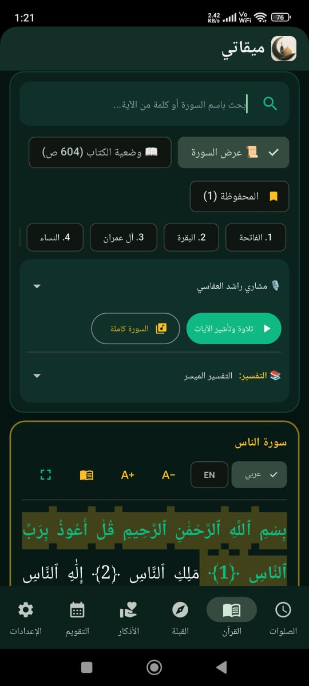
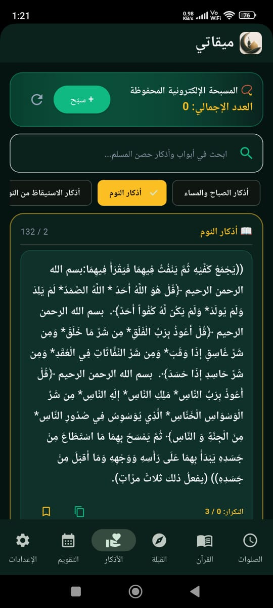
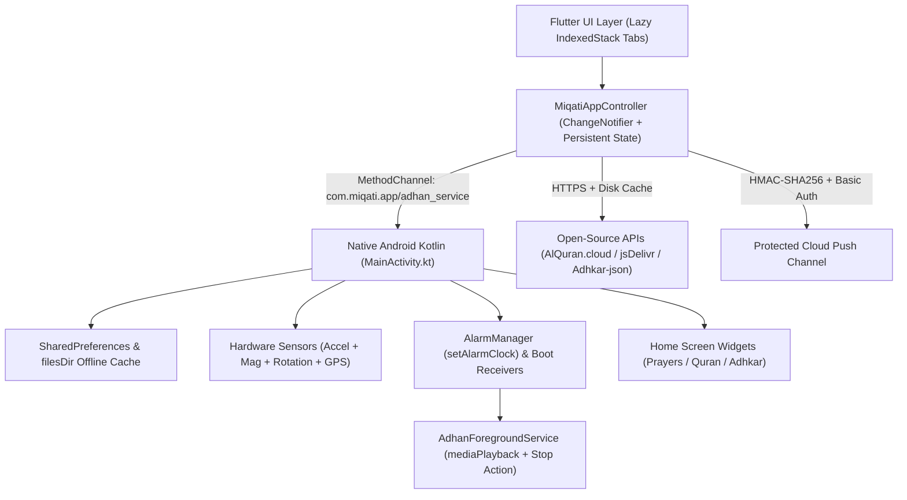
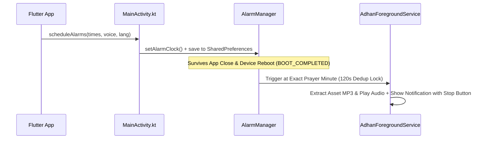

<div align="center">


# Miqati - ميقاتي

**A Complete, Lightweight, Offline-First Islamic Companion Built with Flutter, Dart & Native Android**

*Accurate Prayer Times - 604-Page Connected Mushaf - 6 Sunni Tafsirs - Live Qibla - Hisn al-Muslim - Home Screen Widgets - Protected Admin Console*

[](https://flutter.dev)
[](https://dart.dev)
[](https://developer.android.com)
[](https://developer.apple.com)
[](#)

---

<p dir="rtl" align="center">
<b>ميقاتي (Miqati)</b> — رفيقك اليومي المتكامل لمواقيت الصلاة الدقيقة، القرآن الكريم بوضعية المصحف وتقليب الـ 604 صفحات، 6 تفاسير سنية معتمدة، البوصلة الحية للقبلة، كتاب حصن المسلم، ودجت الشاشة الرئيسية، ولوحة تحكم سرية محمية.
</p>

</div>

---

## Screenshots - صور أقسام التطبيق

| Prayers (الصلوات) | Holy Quran (القرآن الكريم) | Live Qibla (القبلة) |
| :---: | :---: | :---: |
|  |  |  |

| Adhkar & Hisn al-Muslim (الأذكار) | Hijri Calendar (التقويم الهجري) | Advanced Settings (الإعدادات) |
| :---: | :---: | :---: |
|  |  |  |

---

## Key Features - المميزات الرئيسية

### 1. Accurate Prayer Times & Background Adhan (`مواقيت الصلاة والأذان بالخلفية`)
- **Astronomical Calculation Engine**: Supports **Umm al-Qura University**, **Muslim World League (MWL)**, **Egyptian General Authority**, **Karachi**, **ISNA**, **Dubai**, **Qatar**, **Kuwait**, and **Morocco** methods.
- **Auto GPS City Resolution**: Automatically detects coordinates via native Android `LocationManager` + `Geocoder` (displaying **City, Country** cleanly on Home) with nearest-city fallback.
- **Zero-Kill Background Adhan**: Uses `AlarmManager.setAlarmClock` + `AdhanForegroundService` (`mediaPlayback`) + `BOOT_COMPLETED` / `LOCKED_BOOT_COMPLETED` receivers so Adhan rings accurately even when the app is closed or after device reboot.
- **Notification Shade Controls**: Includes a localized **"⏹ Stop Adhan / إيقاف الأذان"** action button directly in the system notification shade, with a **120-second deduplication lock** preventing double triggers.
- **Daily 5-Prayer Tracker & Sunnah Times**: Tracks daily prayers (locking future prayers until their Adhan enters) plus **Duha**, **Midnight**, and **Last Third of the Night**.

### 2. Holy Quran, 604-Page Book Mode & Audio (`القرآن الكريم والمصحف المتصل`)
- **Offline-First Architecture**: Downloads and caches the entire Uthmani Quran (`quran-uthmani`) and Sahih International English translation (`en.sahih`) permanently to `filesDir` on first launch for instant offline reading.
- **604-Page Swipeable Book Mode**: Non-destructive `PageView.builder` with RTL horizontal page flipping, page preloading, **Save Page**, and full-screen Mushaf mode.
- **Streaming Recitation & Auto-Highlight**: Streams Ayah-by-Ayah and full-Surah recitations via `MediaPlayer.prepareAsync()` with automatic Ayah highlighting and tap-to-play support.
- **6 Trusted Sunni Tafsirs (`تفاسير أهل السنة`)**:
  1. التفسير الميسر (*Al-Tafsir Al-Muyassar*)
  2. تفسير ابن كثير (*Tafsir Ibn Kathir*)
  3. تفسير السعدي (*Tafsir Al-Saadi*)
  4. تفسير الطبري (*Tafsir Al-Tabari*)
  5. تفسير القرطبي (*Tafsir Al-Qurtubi*)
  6. تفسير البغوي (*Tafsir Al-Baghawi*)

### 3. Live Dynamic Qibla Compass (`بوصلة القبلة التلقائية`)
- Simultaneously fuses `TYPE_ROTATION_VECTOR`, `TYPE_ACCELEROMETER`, `TYPE_MAGNETIC_FIELD`, and `TYPE_ORIENTATION` with `GeomagneticField` declination compensation.
- Displays real-time Qibla bearing, device heading, distance to Makkah (km), and directional alignment cues in both Arabic and English.

### 4. Hisn al-Muslim Book & Persistent Tasbih (`حصن المسلم والمسبحة`)
- Dynamically fetches and caches the complete open-source **Hisn al-Muslim** (`حصن المسلم`) chapters in a swipeable book interface (`PageView.builder`) with search, copy, bookmarking, tap-to-count, and persistent Tasbih memory.

### 5. Native Android Home Screen Widgets (`ودجات سطح المكتب`)
- **Prayer Times Widget**: Live city, next prayer, and all 5 daily prayer times.
- **Daily Quran Widget**: Rotating Quranic verse + quick jump to your saved Mushaf page.
- **Adhkar & Tasbih Widget**: Rotating authentic Dhikr + interactive **`+ سبّح`** counter directly on the home screen.
- Supports **one-tap pinning** from **Settings → Add Home Screen Widget** via `AppWidgetManager.requestPinAppWidget`.

### 6. Hidden Admin Console & Protected Cloud Push (`لوحة الإدارة المخفية`)
- **Zero Visible Entry Points**: Accessible only via **5 rapid taps** on the header logo or entering `#777#` in the Quran search box, protected by SHA-256 password verification.
- **4 Admin Modules**:
  - **Analytics & Charts**: Real device install ID, usage KPIs, and 7-day `CustomPaint` activity bar chart.
  - **Advanced Push Broadcasts**: Authenticated **HMAC-SHA256** signed notifications via `ntfy.sh` with timestamp deduplication (never replays old alerts).
  - **Branding & Policies**: Live-edit app name, prayer minute offsets, and **About / Privacy Policy** texts.
  - **User Inbox**: View messages submitted from the **Contact Us** form.

---

## Architecture & Data Flow - المخطط الهندسي للتطبيق



### Background Adhan & Boot Persistence Flow



---

## Project Structure - هيكل المشروع

```text
MiqatiCompleteFlutterProject/
├── assets/
│   ├── audio/                        # Local Adhan & Takbir MP3 files
│   └── logo/app_logo.png             # Official Miqati 512x512 PNG logo
├── android/                          # Native Android manifest, widgets, splash & Kotlin code
├── docs/screenshots/                 # App section previews for documentation
├── lib/
│   ├── main.dart                     # Fast startup + overflow error guard
│   ├── config/
│   │   ├── app_branding_and_sounds.dart
│   │   └── miqati_theme.dart         # Emerald & Gold light/dark palette
│   ├── core/
│   │   ├── audio/adhan_audio_service.dart
│   │   └── localization/app_localizations.dart
│   └── features/
│       ├── admin/                    # Admin controller & 4-tab secret vault
│       ├── adhkar/                   # Hisn al-Muslim swipeable book & Tasbih
│       ├── calendar/                 # Hijri calendar, Fridays & occasion countdowns
│       ├── home/                     # Lazy-mounted navigation shell
│       ├── prayer_times/             # Astronomical calculator & live Prayers screen
│       ├── qibla/                    # Multi-sensor live Qibla compass
│       ├── quran/                    # Offline-cached 604-page Quran & 6 Sunni Tafsirs
│       └── settings/                 # Advanced settings, Widgets pin, Contact Us & About
├── tools/
│   ├── MainActivity_template.kt
│   ├── MiqatiWidgets_template.kt
│   └── setup_android_native.py       # Automated Android manifest, icons & widget injector
└── pubspec.yaml
```

---

## Getting Started - التثبيت والتشغيل

### Prerequisites
- **Flutter SDK** (`>= 3.2.0`) & **Dart**
- **Android SDK** (API 24+ minSdk, API 35 compileSdk) or **Xcode** (for iOS)
- **Python 3** (for running `tools/setup_android_native.py`)

### Build & Run on Android

```bash
# 1. Clone the repository
git clone https://github.com/<YOUR_USERNAME>/miqati.git
cd miqati

# 2. (Optional if regenerating android/) Inject native services, widgets, permissions & icons
python3 tools/setup_android_native.py

# 3. Fetch dependencies and run in release mode
flutter clean
flutter pub get
flutter run --release
```

---

## Customization & Security - التخصيص والأمان

1. **Admin Password**: Before publishing your own build, update the placeholder password in `lib/config/app_branding_and_sounds.dart`:
   ```dart
   static const String defaultAdminPasswordPlain = '<YOUR_ADMIN_PASSWORD>';
   ```
   Also update `cloudAccountPassword` and `cloudTopicChannel` in `lib/features/admin/admin_controller.dart`.
2. **App Name & Logo**: Replace `assets/logo/app_logo.png` with your own 512x512 PNG and run `python3 tools/setup_android_native.py` to automatically regenerate all Android `mipmap-*` launcher icons, notification icons, and splash assets.
3. **Adhan Audio Files**: Place your `.mp3` files in `assets/audio/` and register friendly display labels in `AppBrandingAndSounds.defaultAdhanVoices`.

---

## Open-Source Data Sources - المصادر المفتوحة المعتمدة

- **Holy Quran & Translations**: [Al Quran Cloud API](https://alquran.cloud/api) & [Tanzil.net](https://tanzil.net/)
- **Sunni Tafsirs**: [spa5k/tafsir_api](https://github.com/spa5k/tafsir_api)
- **Hisn al-Muslim (حصن المسلم)**: [rn0x/Adhkar-json](https://github.com/rn0x/Adhkar-json)
- **Hijri & Prayer Standards**: [Umm al-Qura Official Calendar](https://www.ummulqura.org.sa/en)

---

## Contact & Developer - المطور والتواصل

- **Developer**: Abdlateef Mohamed — **Latifs MutiServs**
- **Email**: [a@latifs.site](mailto:a@latifs.site)

<div align="center">
<sub>Built with care for the Muslim Ummah - صُنع بإتقان لخدمة المسلمين</sub>
</div>
